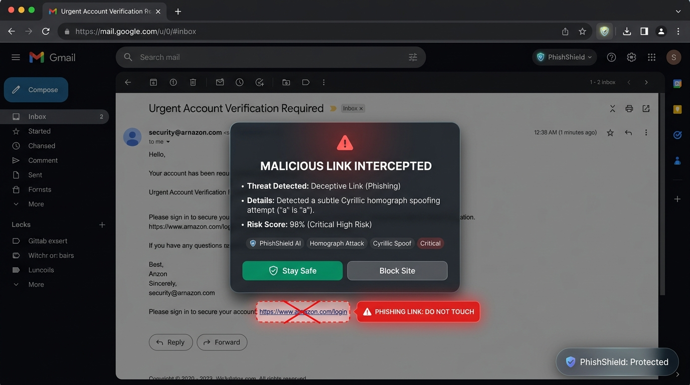

# 🛡️ PhishShield AI - Phishing & Social Engineering Threat Detection Platform

**PhishShield AI** is a multi-layered cybersecurity platform combining an **AI/ML threat detection engine**, an **interactive web dashboard**, and a **real-time browser extension ("PhishShield Browser Guardian")** that actively scans links across all tabs and neutralizes phishing attacks before users can click them.

[](https://github.com/Kidus-yahun/anti_phishing_extension/actions)

[](LICENSE)


<br/>

<div align="center">
  
  <p><em>Real-time in-browser protection: PhishShield AI actively flags Cyrillic homograph attacks, inserts high-visibility warning badges, and intercepts clicks before malicious payloads or credential harvesting forms can open.</em></p>
</div>

---

## 🚨 The Critical Real-World Problem: Why PhishShield AI Matters

Phishing remains the **#1 initial attack vector** responsible for over 80% of reported security breaches globally, resulting in billions of dollars in losses annually. Despite regular security awareness training, individuals and organizations continue to get compromised because modern cyberattacks exploit human psychology and subtle browser mimicry that bypass traditional defenses.

Here is why existing defenses fall short and why **PhishShield AI** is urgently needed:

| Real-World Problem | The Vulnerability / Failure of Existing Tools | How PhishShield AI Solves It |
| :--- | :--- | :--- |
| **Zero-Hour Phishing Blindspot** | Standard browser protections (Google Safe Browsing, Microsoft SmartScreen) rely on static, centralized blacklists. Disposable phishing domains harvest credentials and disappear within the first **20–60 minutes**—hours or days before blacklists ever index them. | **Zero-Latency Client-Side Inspection**: Proactively inspects DOM links and attributes in real-time, executing client-side heuristics and sub-500ms AI decisions directly in the tab before navigation. |
| **Invisible Homograph & IDN Spoofing** | Attackers substitute Latin characters with visually indistinguishable Cyrillic or Unicode lookalikes (e.g. `pаypal.com` with Cyrillic `а`). To the human eye, the link looks 100% authentic. | **Automated Homograph & Punycode Deobfuscation**: Decodes Unicode strings, flags deceptive character sets, and visually highlights spoofed brands before the user can interact. |
| **Deceptive Anchor Discrepancies** | Phishing emails and social media posts display legitimate URLs as the visible text (e.g. `<a href="https://evil-harvest.top">https://paypal.com</a>`). Users click what they see and get compromised. | **DOM-Level Anchor vs Target Verification**: Continuously observes the DOM with `MutationObserver`, comparing displayed label text against real destination `href` attributes, flagging intentional mismatches. |
| **Psychological Urgency & Coercion** | Social engineering attacks exploit panic and artificial urgency ("Account suspended in 2 hours!", "Unauthorized transfer detected"). Panicked users bypass their usual caution. | **Sub-Second NLP Semantic Analysis**: Powered by the **Laya System-1 Decision Engine** (ModernBERT) and offline ML classifiers to flag linguistic pressure tactics, credential harvest cues, and fake authority. |
| **Passive Warnings vs Active Interception** | Traditional browsers display tiny padlock indicators or subtle address bar icons that users regularly overlook. | **Active Pre-Click Interception**: Injects pulsing red badges (`⚠️ PHISHING LINK: DO NOT TOUCH`) directly into the page and completely intercepts clicks with a full-screen warning modal and a 1-click **"Stay Safe"** escape. |
| **Underserved Multilingual Regions** | Most commercial cybersecurity tools are built exclusively for English and Western European languages, leaving African and regional languages (e.g. Amharic, Oromo) completely unprotected. | **Inclusive Multilingual Defense**: Architected with multi-language NLP capability and an open dataset commitment to safeguard underrepresented communities. |

---

## 🌟 Key Features

### 1. 🌐 Real-Time Browser Guardian (Chrome / Edge Extension)
- **Multi-Tab Background Scanning**: Automatically evaluates links across any webpage (like Grammarly) using non-blocking asynchronous batches (`requestAnimationFrame`).
- **Dynamic Content Support**: Uses `MutationObserver` to instantly inspect incoming links in webmail (Gmail, Outlook), social media (X/Twitter, Reddit), and messaging apps.
- **High-Visibility Threat Badges ("Don't Touch It")**: Inserts unmissable, pulsing red warning badges (`⚠️ PHISHING LINK: DO NOT TOUCH`) directly next to flagged links.
- **Active Click Interception**: If a user clicks a malicious link, navigation is immediately blocked, and an unmissable full-screen warning modal appears with threat details and a 1-click **"Stay Safe"** button.
- **Floating Security Pill**: A clean, Grammarly-style corner pill showing the real-time security health of the active tab.

### 2. 🤖 AI/ML Social Engineering NLP Engine
- **Primary (Model #1)**: **Laya System-1 Decision Engine** (`convaiinnovations/laya`) non-autoregressive ModernBERT model delivering sub-second (<500ms on CPU, ~35ms on GPU) multilingual semantic decisions with calibrated confidence.
- **Fallback**: Machine Learning classifier (`LogisticRegression` + `TF-IDF`) for instant offline/cold-start fallback.
- **Urgency & Coercion NLP Heuristics**: Analyzes panic-inducing threats, credential harvesting requests, and authority impersonation cues.

### 3. 🔍 Heuristic URL & Homograph Inspector
- **IDN / Homograph Spoofing Detection**: Identifies Cyrillic/Unicode characters spoofing legitimate domains (e.g. `pаypal.com`).
- **Levenshtein Typosquatting Analyzer**: Flags deceptive typosquatting variants (e.g. `paypa1-security.com`).
- **Anchor Text Mismatch**: Detects when display text claims a trusted domain (`google.com`) but the actual `href` points elsewhere.
- **Structural Analysis**: Flags raw IP hostnames, suspicious TLDs (`.top`, `.xyz`), and URL shorteners.

### 4. ✉️ Email Header Forensic Parser
- Parses RFC822/EML header formats.
- Identifies display name spoofing (e.g., `"PayPal Support" <attacker@random.com>`).
- Checks `From` vs `Return-Path` vs `Reply-To` domain alignment and SPF/DKIM/DMARC flags.

### 5. 🗄️ Threat Intelligence Database & Feed Sync (OpenPhish IOCs)
- **Local Threat Intelligence Engine (`ThreatDatabase`)**: Delivers sub-millisecond O(1) in-memory matching against confirmed phishing domains and URLs.
- **Privacy-Preserving Offline Operation**: Threat feeds are maintained locally (`app/data/threat_feed.json` and `extension/threat_domains.json`), ensuring zero browsing URLs or user telemetry leave the client.
- **Community Feed Integration**: Synchronizes real-time phishing indicators directly from open community feeds (OpenPhish Community Feed: `https://openphish.com/feed.txt`).
- **Immediate 100% Critical Block**: Confirmed malicious links trigger immediate pre-click interception without requiring heavier inference compute.

---

## 📁 Directory Structure

```
PhishShield-AI/
├── app/
│   ├── main.py                  # FastAPI application entrypoint & API routes
│   ├── core/
│   │   ├── nlp_engine.py        # ML classifier & urgency NLP heuristic engine
│   │   ├── url_analyzer.py      # Domain, homograph & typosquatting inspector
│   │   ├── header_analyzer.py   # EML header parser & SPF/DKIM mismatch inspector
│   │   └── risk_scorer.py       # Composite threat scoring aggregator
│   ├── models/
│   │   └── phishing_model.pkl   # Trained Scikit-Learn model weights
│   └── templates/
│       └── index.html           # Tailwind CSS glassmorphic web dashboard
├── extension/                   # 🚀 Chrome / Edge Browser Extension (Manifest V3)
│   ├── manifest.json            # Extension Manifest V3 configuration
│   ├── content.js               # Link scanner, badge injector & click interceptor
│   ├── content.css              # High-visibility pulsing badges & warning modal styles
│   ├── heuristics.js            # Client-side zero-latency threat evaluator
│   ├── service-worker.js        # Tab badge counts & background communications
│   ├── test_page.html           # Interactive test lab for testing the extension
│   ├── icons/                   # Real PNG icons (16x16, 48x48, 128x128)
│   └── popup/                   # Extension popup interface & controls
├── samples/
│   ├── phishing_sample.eml      # Sample phishing email header & text
│   └── legitimate_sample.eml    # Sample safe email header & text
├── docs/                        # Grant proposals, funding calendar & documentation assets
│   ├── assets/                  # Visual assets & extension screenshots
│   └── FUNDING_CALENDAR.md      # Milestones & grant deadlines
├── tests/
│   └── test_detection.py        # Automated test suite
├── train_model.py               # ML training pipeline script
├── requirements.txt             # Python dependencies
└── README.md                    # Documentation
```

---

## 🛠️ How to Install the Browser Extension in Chrome / Edge

1. Open your Chromium-based browser (Google Chrome, Microsoft Edge, Brave, etc.).
2. Navigate to:
   - Chrome: `chrome://extensions`
   - Edge: `edge://extensions`
3. Toggle on **"Developer mode"** in the top-right corner.
4. Click the **"Load unpacked"** button.
5. Select the **`extension`** folder inside this project:
   `C:\Users\Easy Tech\Documents\pro\PhishShield-AI\extension`
6. Pin **PhishShield AI** to your toolbar!

### 🧪 Testing the Extension Immediately
- Double click or open [`extension/test_page.html`](extension/test_page.html) in your browser.
- Watch PhishShield AI automatically flag homograph attacks, typosquatting domains, and deceptive links with pulsing red badges (`⚠️ PHISHING LINK: DO NOT TOUCH`).
- Try clicking any flagged link to see the active full-screen warning modal intercept and block the danger!

---

## 🚀 Running the Python Web Application & API

### 1. Setup Virtual Environment
```bash
cd C:\Users\Easy Tech\Documents\pro\PhishShield-AI

python -m venv venv
# On Windows:
.\venv\Scripts\activate
# On Linux/macOS:
source venv/bin/activate
```

### 2. Install Dependencies & Launch
```bash
pip install -r requirements.txt
python -m uvicorn app.main:app --reload --port 8000
```
Open **[http://127.0.0.1:8000](http://127.0.0.1:8000)** to use the standalone web dashboard.

---

## 🧪 Running Unit Tests

Run the test suite to verify detection engines:
```bash
python -m pytest tests/test_detection.py
```

---

## ❤️ Support this project

PhishShield AI is free and will always keep its core protection free. You can fund its development:

- **GitHub Sponsors** — click the **Sponsor** button at the top of this page
- **Grants** — see [docs/GRANT_ONEPAGER.md](docs/GRANT_ONEPAGER.md) for our funding roadmap
- **Contributions** — code, translations (especially **Amharic/Oromo threat-phrase data**), and false-positive reports are all welcome — see [CONTRIBUTING.md](CONTRIBUTING.md)

---

## 📄 Project documents

| Document | Purpose |
| --- | --- |
| [CONTRIBUTING.md](CONTRIBUTING.md) | How to set up, test, and submit PRs |
| [PRIVACY_POLICY.md](PRIVACY_POLICY.md) | Exactly what data is (and is not) collected |
| [SECURITY.md](SECURITY.md) | Vulnerability disclosure policy |
| [docs/GRANT_ONEPAGER.md](docs/GRANT_ONEPAGER.md) | One-page overview for funders |

---

## 🛡️ License & Educational Disclaimer

This project is released under the **GNU Affero General Public License v3.0** — see [LICENSE](LICENSE). In short: you are free to use, study, share, and modify it; derivative works must remain open source, including when offered as a network service (AGPL §13).

This project is developed for educational, defensive cybersecurity, threat intelligence research, and security awareness training purposes.
